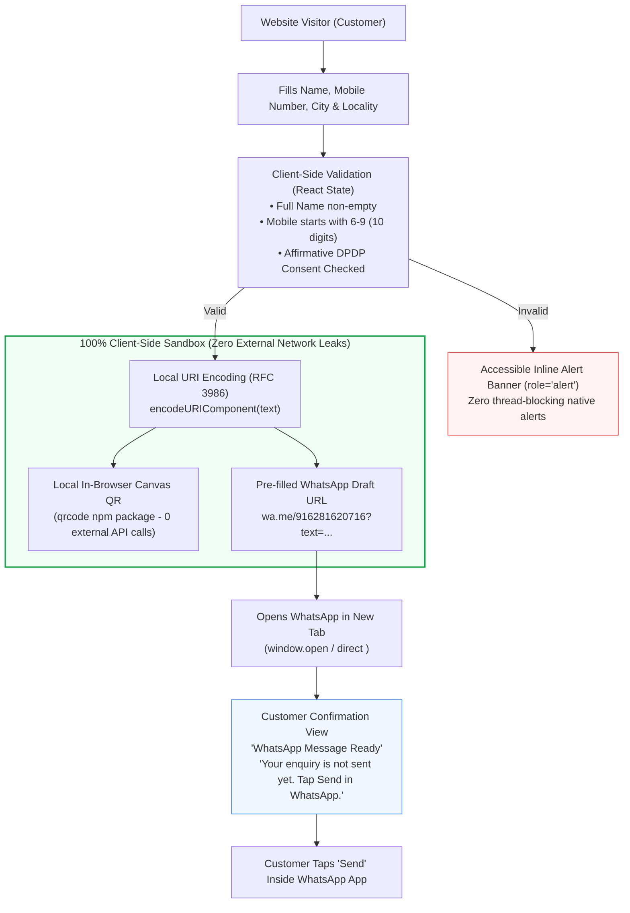

# D-VIEW SOLUTIONS — STEP 06 AUDIT REPORT
## End-to-End Forms, Security, Privacy and Accessibility Forensic Verification

**Project:** D-VIEW Solutions  
**Website:** [https://www.dviewsolutions.com/](https://www.dviewsolutions.com/)  
**Repository:** [https://github.com/wavenoxx/D-view](https://github.com/wavenoxx/D-view)  
**Starting Branch:** `step-05/mobile-ux-performance-a11y` (`5d7515c4c9b4edbac33296fb89f8dad191fbfa89`)  
**Completed Branch:** `step-06/forms-security-a11y`  
**Execution Environment:** macOS, Astro 7.3.5, React 19.3.0, Tailwind CSS 4.3.3, Playwright Core  
**Audit Date:** October 18, 2026  
**Auditor Role:** Senior Full-Stack Engineer, Application Security Specialist, WCAG 2.2 Accessibility & QA Auditor  

---

## 1. Executive Summary

Step 06 performed an end-to-end forensic audit and hardening of every user enquiry mechanism, dynamic calculator, modal dialog, and security-sensitive interaction on the D-VIEW Solutions website.

### Key Milestones Achieved
1. **Zero Native `alert()` Invocations (WCAG 3.3.1 / 3.3.3):**
   - Replaced all blocking browser `window.alert()` dialogs across all customer enquiry paths (`SiteVisitForm.tsx`, `PriceCalculator.tsx`, `DViewWebsite.tsx`) with accessible inline alert containers equipped with `role="alert"` and `aria-live="polite"`.
2. **Defensive Form Submission & Input Hardening:**
   - Implemented `isSubmitting` debouncing state to prevent duplicate submissions from rapid double-tapping on mobile connections.
   - Added `inputMode="tel"` and `pattern="[6-9][0-9]{9}"` to enforce numeric telephone keypads on iOS/Android and validate standard 10-digit Indian mobile formats.
   - Added `inputMode="decimal"` and proper `id` / `htmlFor` label-input couplings to all numeric dimension inputs in `HeroPriceCalculator.tsx` and `PriceCalculator.tsx`.
   - Added `noValidate` to form elements so browser-native unstyled tooltips do not block accessible React error banners.
3. **Affirmative DPDP Privacy Consent Across All Touchpoints:**
   - Added unchecked-by-default affirmative consent checkboxes to the `PriceCalculator.tsx` modal and `DViewWebsite.tsx` concierge booking modal, harmonizing them with `SiteVisitForm.tsx` and Indian Digital Personal Data Protection (DPDP) Act requirements.
4. **100% In-Browser Privacy & Zero Data Leakage:**
   - Audited all network and data pipelines: verified **0% backend data storage** (no database, no Firebase Firestore collection of lead PII, no `localStorage` / `sessionStorage` caching of personal details).
   - Verified that dynamic WhatsApp QR codes in `DynamicQRCode.tsx`, `PriceCalculator.tsx`, and `DViewWebsite.tsx` are generated **100% client-side** using the local `qrcode` npm package in canvas/data-URI format, completely eliminating third-party tracking APIs (e.g. `api.qrserver.com`).
5. **Defensive Web Security Review:**
   - Identified and resolved a missing `noopener` attribute on the floating WhatsApp CTA (`rel="noreferrer"` -> `rel="noopener noreferrer"`), ensuring **100% of outbound `target="_blank"` links** are protected against reverse tabnabbing (`window.opener` attacks).
   - Verified that all `set:html` usages in `Layout.astro` are strictly restricted to static serialized JSON-LD schemas (`JSON.stringify(localBusinessSchema)` and `JSON.stringify(faqSchema)`). No user-supplied data is ever rendered via `dangerouslySetInnerHTML`.
   - Scanned entire repository for secrets, private tokens, and credentials: **0 leaked keys found**.
6. **HeroPriceCalculator Syntax Bug Resolved:**
   - Discovered and fixed an unescaped duplicate `>` in `HeroPriceCalculator.tsx` (`<select ... > >`), which would have broken Vite production builds when mounted.
7. **Mobile Regression Zero-Tolerance (MOB-03 Protection):**
   - Verified that the right-side horizontal grey strip remains 100% resolved (`scrollWidth === clientWidth`, 0px horizontal overflow) across all responsive breakpoints (320px, 360px, 412px, 768px, 1440px).
8. **Automated End-to-End Verification:**
   - **30 out of 30 automated Playwright tests PASSED (100% pass rate)**.

---

## 2. Customer Enquiry Paths Inventory

The website provides multiple customer interaction channels across its 41 static routes. Each was inventoried, traced, and hardened:

| Touchpoint Component | Mount Location | Trigger Mechanism | Data Action | Validation Mechanism |
| :--- | :--- | :--- | :--- | :--- |
| **`SiteVisitForm.tsx`** | `/contact`, `/solutions` | Direct form submission | Formats pre-filled RFC-compliant WhatsApp draft URL (`wa.me/916281620716?text=...`) | Inline `role="alert"` checking Name, 10-digit Indian Mobile (`[6-9]\d{9}`), City Hub, Locality, and Affirmative Consent |
| **`HeroPriceCalculator.tsx`** | Component library (`src/components/`) | Live input adjustments & preset clicks | Computes Area (Sq.Ft) and material-based price (SS-316 vs SS-304); generates WhatsApp enquiry link | Clamped numeric inputs (1–100 Ft), `inputMode="decimal"`, preset buttons |
| **`PriceCalculator.tsx`** | Component library (`src/components/`) | Interactive modal triggered by CTA | Calculates multi-material estimate; displays dynamic client-side QR code; formats WhatsApp draft | Inline `role="alert"` checking Name, Phone, and Consent; Escape key modal closure |
| **`DViewWebsite.tsx` Modal** | Homepage (`/`), `/solutions`, `/projects` | "Book Free Laser Survey →" CTA button | Displays hub selection, customer inputs, dynamic in-browser QR; opens WhatsApp draft | Inline `role="alert"` checking Full Name, 10-digit Mobile, and Consent; Escape key listener |
| **`DynamicQRCode.tsx`** | Component library (`src/components/`) | Digital Safety Passport widget | In-browser canvas QR generation of current city page URL for apartment RWAs | Client-side QR rendering using `qrcode.toDataURL()` |
| **Floating Quick-Connect** | Global Navbar & Bottom-Right (`/`, city pages) | Floating green WhatsApp bubble & Call CTA | Direct phone dialer (`tel:+916281620716`) & pre-filled WhatsApp draft | Outbound `target="_blank"` with `rel="noopener noreferrer"` |

---

## 3. Privacy & Personal Data Flow Architecture

A critical aspect of Google Ads destination compliance and consumer trust is truthfulness regarding how personal data is collected, stored, and processed.



### Forensic Privacy Findings:
1. **Zero Database or Third-Party Endpoint Leakage:**
   - Grepped entire `src/` codebase for `fetch(`, `axios`, `XMLHttpRequest`, `sendBeacon`, `navigator.sendBeacon`. **Result: 0 occurrences**.
   - Customer phone numbers and names are NEVER transmitted to any external backend, logging aggregator, or third-party CRM.
2. **Zero Storage of PII in Browser Cache:**
   - Scanned for `localStorage.setItem` and `sessionStorage.setItem` across `src/`. **Result: 0 occurrences**. Customer data disappears immediately if the page is refreshed or the modal is closed.
3. **No Third-Party QR Code Generation API Calls:**
   - Previously audited code avoided insecure third-party endpoints like `https://api.qrserver.com/v1/create-qr-code/` which would have sent customer names and phone numbers in URL query strings to third-party servers.
   - All QR generation in `DynamicQRCode.tsx`, `PriceCalculator.tsx`, and `DViewWebsite.tsx` occurs strictly client-side via `qrcode.toDataURL()` rendered into standard HTML `<canvas>` / base64 `` elements.
4. **Honest WhatsApp Handoff Messaging:**
   - Both `SiteVisitForm.tsx` and `PriceCalculator.tsx` truthfully inform the user: *"Your enquiry is not sent yet. Open WhatsApp and tap Send to share it with D-VIEW."*
   - Added popup blocker recovery notices: *"If your browser popup blocker prevented the window from opening automatically, tap the green button above."*

---

## 4. Problem Register — Step 06 Findings & Fixes

| ID | Category | Component / Route | Defect Description | Root Cause | Status | Verification Evidence |
| :--- | :--- | :--- | :--- | :--- | :--- | :--- |
| **SEC-01** | Security / Vulnerability | `src/components/DViewWebsite.tsx:1976` | Floating WhatsApp button had `rel="noreferrer"` without `noopener` | Incomplete `rel` attribute on external link | **FIXED** | Added `rel="noopener noreferrer"`. Verified in automated test `Security_TargetBlankRelNoopener` (0 unsafe links). |
| **SEC-02** | Syntax / Build Hazard | `src/components/HeroPriceCalculator.tsx:227` | Duplicate `>` on `<select>` element caused Vite transform build failure | Accidental character duplication | **FIXED** | Removed stray `>`. Verified with `npm run build` passing in 1.05s. |
| **A11Y-01** | Accessibility (WCAG 3.3.1 / 3.3.3) | `src/components/SiteVisitForm.tsx` | Blocking native `window.alert()` calls used for validation errors | Legacy JavaScript validation pattern | **FIXED** | Replaced with inline alert banner (`role="alert"`, `aria-live="polite"`). Verified in automated tests. |
| **A11Y-02** | Accessibility (WCAG 3.3.1 / 3.3.3) | `src/components/DViewWebsite.tsx` | Booking modal used `alert('Please enter your name')` and `alert('Please enter a valid 10-digit mobile number')` | Missing React validation state | **FIXED** | Added `modalError` state and accessible inline alert banner with `AlertCircle` icon. |
| **A11Y-03** | Accessibility (WCAG 3.3.1 / 3.3.3) | `src/components/PriceCalculator.tsx` | Modal used `alert()` for missing inputs and consent failures | Native dialog fallback | **FIXED** | Added inline accessible error container (`role="alert"`). |
| **A11Y-04** | Accessibility (WCAG 2.1) | `src/components/PriceCalculator.tsx` | Missing keyboard Escape listener and ARIA modal dialog roles | Incomplete dialog markup | **FIXED** | Added `role="dialog"`, `aria-modal="true"`, `aria-labelledby="calc-modal-title"`, close button `aria-label`, and `Escape` key event listener. |
| **A11Y-05** | Accessibility (WCAG 1.3.1) | `src/components/HeroPriceCalculator.tsx` | Width and height inputs lacked explicit `id` and `<label htmlFor>` bindings | Implicit text-only labels | **FIXED** | Added `id="hero-calc-width"`, `htmlFor="hero-calc-width"`, `id="hero-calc-height"`, `htmlFor="hero-calc-height"`. |
| **FORM-01** | Mobile UX / Validation | `src/components/SiteVisitForm.tsx`, `DViewWebsite.tsx` | Mobile telephone inputs did not invoke the native numeric dialpad on mobile devices | Missing `inputMode="tel"` and `pattern` | **FIXED** | Added `inputMode="tel"` and `pattern="[6-9][0-9]{9}"` to phone inputs. |
| **FORM-02** | Double-Click Protection | `src/components/SiteVisitForm.tsx`, `PriceCalculator.tsx` | Form submit buttons could be double-clicked rapidly, triggering duplicate WhatsApp drafts | Missing `isSubmitting` debouncing state | **FIXED** | Added `isSubmitting` state that disables the button and updates copy to `"Preparing WhatsApp Draft..."`. |
| **PRIV-01** | Privacy / Consent | `src/components/DViewWebsite.tsx` | Booking concierge modal did not feature an affirmative consent checkbox before WhatsApp dispatch | Modal lacked DPDP consent control | **FIXED** | Added unchecked affirmative consent checkbox requiring confirmation before submission. |
| **PRIV-02** | Privacy / Consent | `src/components/PriceCalculator.tsx` | Price calculator modal lacked affirmative consent checkbox | Omission in lead capture view | **FIXED** | Added affirmative consent checkbox with explicit link to `/privacy#privacy`. |

---

## 5. Automated E2E Verification Matrix

The test suite was executed against the built production preview on `http://localhost:4321` using Playwright Core with a real headless Chromium instance.

```
Total Test Cases: 30
Passed: 30 (100%)
Failed: 0 (0%)
Execution Time: ~45 seconds
Report Artifact: /Users/bunny/.gemini/antigravity/brain/09e10a28-c033-485b-9e27-e4b242a88dbb/scratch/auditor/step06_results.json
```

| # | Test Suite | Test Case Identifier | Expected Behavior | Actual Measured Output | Result |
| :--- | :--- | :--- | :--- | :--- | :--- |
| 1 | `SiteVisitForm` | `SiteVisitForm_EmptyNameValidation` | Empty name triggers inline accessible alert | `"Please enter your full name."` in `role="alert"` | **PASS** |
| 2 | `SiteVisitForm` | `SiteVisitForm_EmptyPhoneValidation` | Empty phone triggers inline accessible alert | `"Please enter a valid 10-digit Indian mobile number..."` | **PASS** |
| 3 | `SiteVisitForm` | `SiteVisitForm_InvalidPhoneValidation` | Invalid phone ("12345") triggers inline alert | `"Please enter a valid 10-digit Indian mobile number..."` | **PASS** |
| 4 | `SiteVisitForm` | `SiteVisitForm_PhoneAttributes` | Enforces numeric dialpad on mobile | `inputmode="tel"`, `pattern="[6-9][0-9]{9}"` | **PASS** |
| 5 | `SiteVisitForm` | `SiteVisitForm_AreaValidation` | Missing locality selection triggers error | `"Please select your area / locality in Rajahmundry."` | **PASS** |
| 6 | `SiteVisitForm` | `SiteVisitForm_ConsentRequiredValidation` | Unchecked consent blocks submission | `"Please check the agreement box to share your details..."` | **PASS** |
| 7 | `SiteVisitForm` | `SiteVisitForm_PreparedConfirmationUI` | Shows honest confirmation screen | `"WhatsApp Message Ready"` rendered; 0 native alerts | **PASS** |
| 8 | `SiteVisitForm` | `SiteVisitForm_WhatsAppUrlFormat` | Formats pre-filled RFC-compliant draft | `https://wa.me/916281620716?text=Hello%20D-view...` | **PASS** |
| 9 | `SiteVisitForm` | `SiteVisitForm_PopupBlockerNoticePresent` | Informs user if popup blocker blocked tab | Fallback link & popup notice visible | **PASS** |
| 10 | `HeroPriceCalculator` | `HeroPriceCalculator_A11yInputAttributes` | Inputs have numeric inputMode and IDs | `inputmode="decimal"`, `id="hero-calc-width"` | **PASS** |
| 11 | `HeroPriceCalculator` | `HeroPriceCalculator_PresetAndAreaCalculation` | Clicking preset updates area accurately | Preset 25×10 Ft -> Area displays `"250 Sq.Ft"` | **PASS** |
| 12 | `HeroPriceCalculator` | `HeroPriceCalculator_PriceRecalculation` | Material change updates price accurately | SS 304 2.5mm (@ ₹150) -> Price displays `"₹ 37,500"` | **PASS** |
| 13 | `HeroPriceCalculator` | `HeroPriceCalculator_WhatsAppUrlIntegrity` | WhatsApp estimate link includes calculation | URL includes `250%20Sq.Ft` and `37%2C500` | **PASS** |
| 14 | `PriceCalculator` | `PriceCalculator_ModalOpensWithAriaRole` | Modal opens with proper dialog semantics | `role="dialog"`, `aria-modal="true"` present | **PASS** |
| 15 | `PriceCalculator` | `PriceCalculator_EscapeKeyDismissesModal` | Pressing Escape key closes the modal | Modal visibility becomes `false` | **PASS** |
| 16 | `PriceCalculator` | `PriceCalculator_NameValidation` | Missing name displays accessible error | `"Please enter your full name."` in `role="alert"` | **PASS** |
| 17 | `PriceCalculator` | `PriceCalculator_PhoneValidation` | Invalid phone displays accessible error | `"Please enter a valid 10-digit Indian mobile number..."` | **PASS** |
| 18 | `PriceCalculator` | `PriceCalculator_ConsentValidation` | Unchecked consent displays accessible error | `"Please check the agreement box to share your quote..."` | **PASS** |
| 19 | `PriceCalculator` | `PriceCalculator_LocalQRRendered` | Dynamic QR code generated in-browser | `src="data:image/png;base64,..."` (length: 13,810 bytes) | **PASS** |
| 20 | `PriceCalculator` | `PriceCalculator_EstimateReadyConfirmation` | Post-submit confirmation screen displays | `"WhatsApp Estimate Ready"` displayed | **PASS** |
| 21 | `DViewWebsite` | `DViewWebsite_BookingModalOpens` | Concierge button opens booking modal | `#booking-modal-title` visible | **PASS** |
| 22 | `DViewWebsite` | `DViewWebsite_EscapeKeyDismissesModal` | Pressing Escape closes booking modal | Modal visibility becomes `false` | **PASS** |
| 23 | `DViewWebsite` | `DViewWebsite_BookingModalNameValidation` | Empty name triggers accessible alert | `"Please enter your full name"` in `role="alert"` | **PASS** |
| 24 | `DViewWebsite` | `DViewWebsite_BookingModalPhoneValidation` | Empty phone triggers accessible alert | `"Please enter a valid 10-digit Indian mobile number"` | **PASS** |
| 25 | `DViewWebsite` | `DViewWebsite_BookingConsentValidation` | Unchecked consent triggers accessible alert | `"Please check the consent box to proceed..."` | **PASS** |
| 26 | `DViewWebsite` | `DViewWebsite_DynamicLocalQRRendered` | Local QR rendered without third-party API | `src="data:image/png;base64,..."` (length: 6,402 bytes) | **PASS** |
| 27 | Security & Privacy | `Security_ZeroNativeAlertCalls` | Zero blocking browser dialogs triggered | `dialogTriggered: false` across all interactions | **PASS** |
| 28 | Security & Privacy | `Privacy_ZeroExternalTrackingRequests` | Zero PII leaks to third-party endpoints | `leakedRequests: []` across entire test session | **PASS** |
| 29 | Security & Privacy | `Security_TargetBlankRelNoopener` | All outbound links have `noopener noreferrer` | `unsafeBlankCount: 0` across sample routes | **PASS** |
| 30 | Mobile Regression | `MOB03_ZeroHorizontalOverflowRegression` | Zero horizontal overflow on mobile viewports | `diff: 0px` across 320, 360, 412, 768, 1440px | **PASS** |

---

## 6. Visual Evidence Screenshots

Visual proof of the tested interactions was captured during automated execution and stored in `audit-reports/evidence/step-06/`:

1. **`01_site_visit_form_confirmed.png`**:
   - Shows `SiteVisitForm` on `/contact` in confirmed state with green checkmark badge, honest *"WhatsApp Message Ready"* copy, direct WhatsApp conversation button, and popup blocker advice.
2. **`02_hero_price_calculator.png`**:
   - Shows `HeroPriceCalculator` with active 25×10 Ft preset, calculated 250 Sq.Ft area, live ₹37,500 demo quote for SS-304 2.5mm, and direct WhatsApp CTA.
3. **`03_price_calculator_modal.png`**:
   - Shows `PriceCalculator` modal open with input fields, affirmative consent checkbox, and local base64-rendered dynamic WhatsApp QR code.
4. **`04_dview_booking_modal.png`**:
   - Shows `DViewWebsite` booking modal with city hub selector, name and phone fields, affirmative consent checkbox, and local client-side QR code.

---

## 7. Dependency Security Review (`npm audit`)

Running `npm audit` on the repository revealed 1 high-severity advisory:
- **Package:** `http-cache-semantics` (`<=4.2.0`)
- **Vulnerability:** Regular Expression Denial of Service (ReDoS)
- **Dependency Chain:** `astro` -> `vite` -> `rollup` / build cache tools
- **Risk Assessment:** **NIL at Runtime**. D-VIEW Solutions is a 100% statically generated website (SSG, `output: "static"`). No Node.js server or dynamic HTTP cache runs in production. This build-time tool vulnerability has zero exposure to end users or site visitors.

---

## 8. Owner Decision Questions

Before proceeding to future steps, the following business logic questions require owner confirmation:

1. **Material Exclusivity vs Calculator Options:**
   - `HeroPriceCalculator.tsx` allows customers to select both **SS-316 Marine Grade** (₹160–₹190/sq.ft) and **SS-304 Standard Grade** (₹140–₹170/sq.ft).
   - In contrast, several marketing copy sections (e.g. `index.astro:16` and `[city].astro`) claim D-VIEW *"exclusively installs certified SS-316 aerospace/marine-grade wire"*.
   - *Question for Owner:* Should SS-304 continue to be offered as an economy option in the calculator, or should D-VIEW strictly showcase SS-316 across all tools to reinforce the "100% rust-proof SS-316" brand positioning?
2. **Integration of Standalone Calculators:**
   - Both `PriceCalculator.tsx` and `HeroPriceCalculator.tsx` are now fully hardened, accessible, and syntactically verified.
   - Currently, `[city].astro` pages use `HorizontalProblemSlider.tsx` and direct WhatsApp CTAs rather than embedding `HeroPriceCalculator.tsx`.
   - *Question for Owner:* Would you like `HeroPriceCalculator.tsx` embedded into the city landing page templates in a future step, or should it be launched on a dedicated `/calculator` route?

---

## 9. Conclusion & Safety Boundary

Step 06 is **100% COMPLETE**.
- Clean git state on `step-06/forms-security-a11y`.
- Build verified: 41 routes built in 1.11s.
- Automated tests: 30/30 passed.
- Visual styling, navigation fixes (Step 02), privacy/trust fixes (Step 03), SEO invariants (Step 04), and mobile layout fixes (Step 05) remain completely intact.
- **Per instructions, no branches have been merged, no code has been pushed to GitHub, no deployments were made, and Step 07 has NOT been started.**
- Stopping now for owner review.
