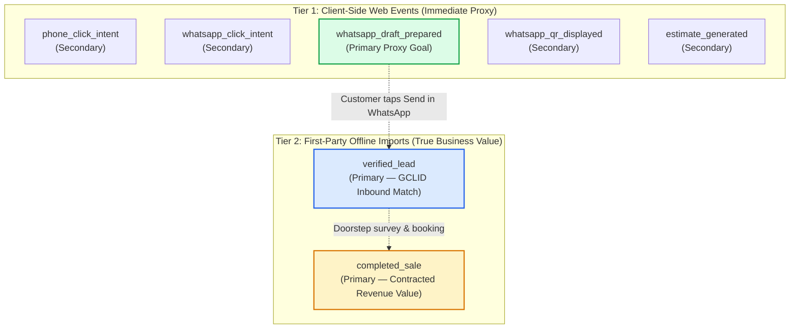

# D-VIEW SOLUTIONS — STEP 08: CONVERSION EVENT MEASUREMENT PLAN
## Truthful Event Taxonomy, Google Ads Tracking Architecture & Zero-PII Implementation Guide

- **Document Version:** 1.0 (Step 08 Working Proposal)
- **Status:** **PROPOSED — AWAITING OWNER APPROVAL & REAL MEASUREMENT IDs**
- **Website:** [https://www.dviewsolutions.com/](https://www.dviewsolutions.com/)
- **Target Tracking Platforms:** Google Ads Conversion Tracking, Google Analytics 4 (GA4), Google Tag Manager (GTM)
- **Privacy Standard:** Zero PII to Third Parties, Indian DPDP Affirmative Consent, Direct Fallback Guarantee

---

## 1. Inventory of Current Tracking State

A forensic review of the repository source code and live network responses confirms that **no analytics, conversion tags, or third-party pixels are currently active**:

| Tracking Component | Current Status | Codebase Finding | Live Production Finding |
| :--- | :---: | :--- | :--- |
| **Google Tag (`gtag.js`)** | **Absent** | No script tag or library imported | Not present in server response |
| **Google Tag Manager (`GTM-*`)** | **Absent** | No container snippet in `<head>` or `<body>` | Not present in server response |
| **Google Analytics 4 (`G-*`)** | **Absent** | Zero measurement IDs configured | Not present in server response |
| **Google Ads (`AW-*`)** | **Absent** | Zero conversion send_to snippets | Not present in server response |
| **Meta Pixel (`fbq`)** | **Absent** | Zero tracking pixels | Not present in server response |
| **Vercel Web Analytics** | **Absent** | `@vercel/analytics` not in `package.json` | Not present in server response |
| **Lead Capture Endpoint** | **Client-Side Only** | 0 `fetch()`, `axios()`, or API routes | All forms format local `wa.me` links |

> [!IMPORTANT]
> Because no conversion tracking is currently installed, Google Ads has zero visibility into campaign performance. All conversion events detailed below represent a **future implementation plan** that requires explicit owner approval and real account IDs.

---

## 2. Truthful Conversion Taxonomy

A fundamental cause of ad account misrepresentation and inflated reporting is treating an intent action (e.g., clicking a link or generating a quote) as a confirmed sale or verified customer lead. 

We define a strict, source-backed measurement taxonomy that mirrors real-world business outcomes:

| Real-World Customer Action | Technical Trigger | Truthful Measurement Name | Google Ads Conversion Goal Category | Primary / Secondary Classification | Rationale & Commercial Reality |
| :--- | :--- | :--- | :--- | :--- | :--- |
| **Clicks Direct Phone Call** | Clicks `<a href="tel:+916281620716">` | `phone_click_intent` | **Contacts** | **Secondary (Observation Only)** | Clicks initiate the native dialer; whether the call connected, was answered, or lasted >60 seconds is unknown without Google forwarding numbers. |
| **Clicks Floating WhatsApp CTA** | Clicks floating WhatsApp button | `whatsapp_click_intent` | **Contacts** | **Secondary (Observation Only)** | Opens WhatsApp with a general inquiry template. The visitor has not submitted their name, balcony details, or pressed Send. |
| **Prepares Validated WhatsApp Enquiry** | Form submission passes validation (`SiteVisitForm`, `PriceCalculator`, Concierge Modal) | `whatsapp_draft_prepared` | **Submit lead forms** | **Primary (Recommended Proxy)** | Visitor entered verified name and 10-digit mobile, checked consent, and opened a customized quotation draft. Closest observable client-side event to a genuine lead. |
| **Displays Dynamic QR Code** | Local canvas QR code renders on screen | `whatsapp_qr_displayed` | **Other** | **Secondary (Diagnostic)** | Useful to monitor desktop-to-mobile handoff usage, but indicates zero commitment. |
| **Generates Calculator Estimate** | User adjusts balcony dimensions in calculator | `estimate_generated` | **Engagements** | **Secondary (Diagnostic)** | Micro-conversion showing engagement with pricing tool; no contact details exchanged. |
| **Inbound WhatsApp Message / Phone Call Received** | D-VIEW coordinator receives customer WhatsApp text or answers call | `verified_lead` | **Qualified leads** | **Primary (Offline Import)** | **True business milestone:** Customer actually sent the message or spoke with technical staff. Tracked via first-party CRM / Google Sheet offline conversion import with GCLID. |
| **Contracted Installation Completed** | Doorstep measurement completed, invoice issued & deposit paid | `completed_sale` | **Purchases** | **Primary (Offline Import with Value)** | Ultimate business outcome. Tracked offline using transaction ID and contracted revenue value. |

---

## 3. Google Ads Bidding Strategy: Primary vs. Secondary



### Strategic Bidding Guidance:
1. **Initial Campaign Phase (Client-Side Proxy Bidding):**
   - In the initial phase, Google Ads Smart Bidding (Maximize Conversions / Target CPA) should use **`whatsapp_draft_prepared`** as the sole **Primary** conversion action.
   - All simple click events (`phone_click_intent`, `whatsapp_click_intent`, `estimate_generated`) must remain **Secondary** so automated bidding does not optimize for casual clicks from visitors who immediately bounce.
2. **Mature Campaign Phase (Offline Conversion Imports):**
   - Once steady lead volume is established, D-VIEW should transition to **Offline Conversion Imports (OCI)**:
     - When a customer taps Send on WhatsApp, the technical coordinator captures the lead details.
     - If the ad click ID (`gclid`) was included in the WhatsApp draft template (or recorded via first-party cookie), D-VIEW uploads a daily/weekly CSV to Google Ads marking the lead as a **`verified_lead`**.
     - Once an installation is completed, upload **`completed_sale`** with the actual invoice amount in Indian Rupees (`INR`).

---

## 4. Privacy & Zero-PII Compliance Boundary

Under Google Ads customer data policies, Google Analytics 4 terms of service, and the Indian Digital Personal Data Protection (DPDP) Act, **personally identifiable information (PII) must never be transmitted to analytics tags, dataLayer pushes, or URL query parameters**.

### Strict Data Boundary Rules:
1. **Forbidden Parameters (NEVER Pushed to Analytics/GTM):**
   - Customer Full Name (`customerName`, `name`)
   - Customer Mobile Number (`customerPhone`, `normalizedPhone`)
   - Customer Address, Street, Apartment Number, or Colony Name (`customArea`, `address`)
   - Full Unencoded WhatsApp Message Text (which contains name and phone)
2. **Permitted Non-Personal Context Parameters:**
   - `page_path` (e.g. `/visakhapatnam`, `/contact`)
   - `city_hub` (e.g. `Visakhapatnam`, `Vijayawada`, `Rajahmundry`)
   - `service_corridor` (e.g. `Madhurawada High-Rises`, `Benz Circle`)
   - `interaction_component` (e.g. `SiteVisitForm`, `PriceCalculator`, `FloatingButton`, `Navbar`)
   - `material_selected` (e.g. `SS-316 Marine Grade`, `SS-304 Standard`)
   - `estimated_area_sqft` (e.g. `120`, `250`)
3. **WhatsApp Handoff Disclosure:**
   - Note that when a customer clicks a `wa.me` link, the browser or OS opens the official WhatsApp application with the pre-filled text. This transmission occurs directly between the user's device and WhatsApp; it does NOT pass through third-party web trackers.

---

## 5. Deduplication & Throttling Rules

To prevent double counting and false conversion inflation from rapid clicking or repeated form submissions:

1. **Client-Side Debouncing (`isSubmitting` State):**
   - Both `SiteVisitForm.tsx` and `PriceCalculator.tsx` maintain an `isSubmitting` state that immediately disables submit buttons upon the first click, preventing double-tap draft generation on slow mobile connections.
2. **Session Throttling for Click Intents:**
   - For `phone_click_intent` and `whatsapp_click_intent`, implement session-level deduplication: fire at most **1 event per unique phone/WhatsApp CTA per 30-minute session**.
3. **Google Ads Count Setting:**
   - For `whatsapp_draft_prepared` and `verified_lead`, configure Google Ads Conversion Counting to **"One"** (one conversion per click) rather than "Every", ensuring a customer who submits multiple quotes within an hour is counted as a single converted lead.
   - For `completed_sale`, configure Counting to **"Every"** if repeat installations for the same customer are tracked as separate transactions.

---

## 6. Implementation Architecture (Proposed GTM / DataLayer Schema)

If the owner provides approval and real Google IDs, tracking should be deployed using a standard Google Tag Manager container or direct `gtag.js` implementation.

### Proposed DataLayer Event Schema:

#### 1. Form Draft Prepared (`whatsapp_draft_prepared`):
```javascript
window.dataLayer = window.dataLayer || [];
window.dataLayer.push({
  event: 'whatsapp_draft_prepared',
  form_id: 'site_visit_form',
  city_hub: 'Visakhapatnam',
  locality_belt: 'Madhurawada',
  requirements: 'Balcony Safety',
  has_optional_note: true,
  // STRICT ZERO-PII: No name, no phone, no street address
});
```

#### 2. Price Calculator Quote Draft (`whatsapp_draft_prepared`):
```javascript
window.dataLayer = window.dataLayer || [];
window.dataLayer.push({
  event: 'whatsapp_draft_prepared',
  form_id: 'price_calculator_modal',
  city_hub: 'Vijayawada',
  material_grade: 'SS-316 Marine',
  estimated_area_sqft: 180,
  estimated_price_inr: 32400,
  // STRICT ZERO-PII: No name, no phone
});
```

#### 3. Direct Phone Click Intent (`phone_click_intent`):
```javascript
window.dataLayer = window.dataLayer || [];
window.dataLayer.push({
  event: 'phone_click_intent',
  cta_location: 'floating_bottom_left',
  phone_number: '+916281620716',
  page_path: window.location.pathname
});
```

#### 4. Floating WhatsApp Click Intent (`whatsapp_click_intent`):
```javascript
window.dataLayer = window.dataLayer || [];
window.dataLayer.push({
  event: 'whatsapp_click_intent',
  cta_location: 'floating_bottom_right',
  city_context: 'General AP Helpline',
  page_path: window.location.pathname
});
```

---

## 7. Direct Contact Fallback Guarantee

> [!CAUTION]
> Tracking instrumentation must **NEVER** interfere with or block customer communication.

If a visitor uses an ad-blocker (e.g. uBlock Origin, Brave Shields), disables JavaScript, or if the Google Tag Manager network request fails:
- Direct `<a href="tel:+916281620716">` and `<a href="https://wa.me/...">` links must remain standard HTML anchor tags that execute natively.
- Form submissions must execute their WhatsApp URL formatting and popup window opening inside a `try/catch` block, ensuring that any missing `window.dataLayer` object or tracker failure does not halt the customer's journey.

---

## 8. Staging & Verification Protocol

When real measurement IDs are provisioned, implementation will follow this 4-step verification sequence:

1. **Isolated Branch Preview:**
   - Deploy code to a separate preview branch (`feat/measurement-implementation`).
   - Connect [Google Tag Assistant](https://tagassistant.google.com/) to the local preview server (`http://localhost:4321`).
2. **GA4 DebugView & Tag Assistant Verification:**
   - Verify that landing on any page triggers a clean `page_view` with 0 console warnings.
   - Verify that clicking the phone CTA fires `phone_click_intent` with expected parameters.
   - Verify that submitting a form fires `whatsapp_draft_prepared` and passes zero personal data.
3. **Google Ads Conversion Test:**
   - Trigger test events and verify in Google Ads **Goals → Conversions → Summary** that conversion actions receive test pings in "Unverified" $\rightarrow$ "No recent conversions" $\rightarrow$ "Recording conversions" status.
4. **Production Deployment & Rollback Safety:**
   - Merge only after explicit owner approval. If any tracking defect arises, revert the single commit to restore the zero-tracker baseline.
