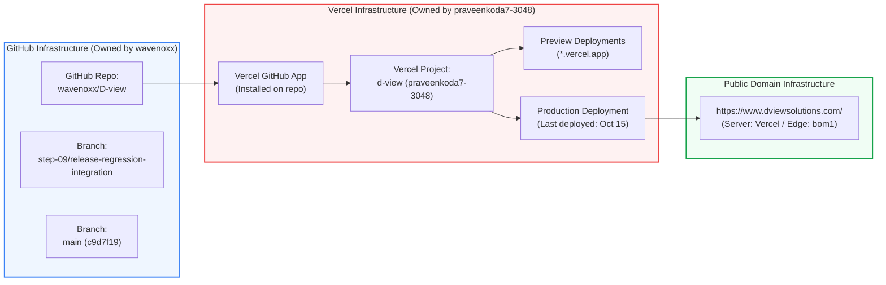
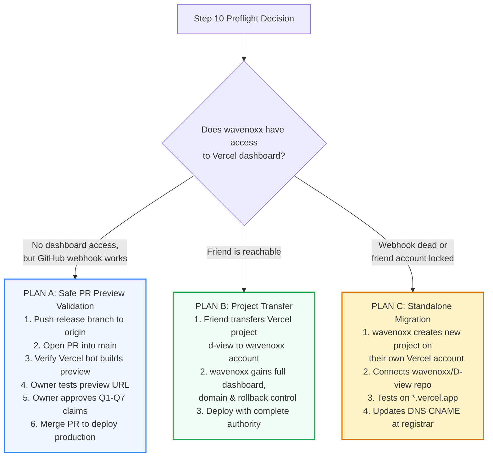

# D-VIEW SOLUTIONS — STEP 09: PRODUCTION DEPLOYMENT PREFLIGHT & ROLLOUT PLAN
## GitHub $\rightarrow$ Vercel Infrastructure Forensic Analysis, Rollout Decision Tree & Rollback Safeguards

- **Document Version:** 1.0 (Preflight Planning Only — **DO NOT EXECUTE WITHOUT OWNER INSTRUCTION**)
- **Target Repository:** `https://github.com/wavenoxx/D-view`
- **Release Candidate Branch:** `step-09/release-regression-integration` (`b360bdd`)
- **Live Production URL:** `https://www.dviewsolutions.com/`

---

## 1. Forensic Ownership & Infrastructure Analysis

A forensic inspection of the repository history, GitHub API commit statuses, and public HTTP responses establishes the following infrastructure reality:



### Key Technical Facts Established:
1. **GitHub Repository Ownership:**
   - The repository `wavenoxx/D-view` is owned by the current project owner (`wavenoxx`).
2. **Vercel Project Ownership Split:**
   - The Vercel GitHub App integration links this repo to a Vercel project named `d-view` under the user account **`praveenkoda7-3048`** (`https://vercel.com/praveenkoda7-3048/d-view`).
   - The friend who controls `praveenkoda7-3048` is currently unavailable.
3. **Confirmed Webhook Activity:**
   - On **Oct 15, 2026 at 06:39 UTC**, commit `c9d7f19` on `main` was automatically built and deployed to production by `vercel[bot]` (`target_url: https://vercel.com/praveenkoda7-3048/d-view/9iXDoU79bM661C957HjNr2YeJReD`).
   - On **Oct 17, 2026 at 13:29 UTC**, opening PR #1 (`469cb5b`) automatically triggered a Vercel **Preview Deployment** (`https://d-view-git-audit-ads-trust-privacy-loa-41ff8d-praveenkoda7-3048.vercel.app`).
4. **Current Live Production State:**
   - Public curl inspection shows `https://www.dviewsolutions.com/` serves commit `c9d7f19` (`last-modified: Thu, 15 Oct 2026 21:25:16 GMT`, `server: Vercel`, `x-vercel-id: bom1::...`).
5. **The Operational Risk:**
   - While the Vercel GitHub App is currently connected, **merging into `main` without direct Vercel dashboard access is risky**:
     - If the build fails on Vercel, or if `praveenkoda7-3048` has hit monthly build execution limits, the site will fail to deploy or stay on the old version.
     - The owner has no direct button to trigger a rollback in the Vercel UI if an issue arises.

---

## 2. Step 10 Rollout Decision Tree (Plans A, B & C)



### Detailed Execution Protocols:

### PLAN A: Safe PR Preview Validation (Zero Account Disruption)
*Use this plan if the existing Vercel webhook is still operational and the owner wants to update production without waiting for friend credentials.*
1. **Push Release Branch:**
   ```bash
   git push origin step-09/release-regression-integration
   ```
2. **Open Pull Request on GitHub:**
   - Open a PR from `step-09/release-regression-integration` into `main`.
   - Do NOT merge immediately.
3. **Inspect Vercel Bot Preview Deployment:**
   - Wait 60–90 seconds for `vercel[bot]` to post a preview deployment URL comment on the PR (e.g. `https://d-view-git-step-09-...-praveenkoda7-3048.vercel.app`).
   - If the preview build fails, review the build log via GitHub check details without touching production.
4. **Smoke Test the Live Preview URL:**
   - Test candidate city landing pages, contact form, calculators, and mobile responsiveness on the Vercel preview domain.
5. **Owner Approval Gate:**
   - Confirm owner sign-off on Step 07 Questions Q1–Q7.
6. **Merge PR:**
   - Merge PR into `main`.
   - Inspect public `https://www.dviewsolutions.com/` to verify headers update and the live site reflects the release candidate.

### PLAN B: Project Transfer to Owner Account (Recommended for Long-Term Governance)
*Use this plan if the friend becomes reachable for 10 minutes.*
1. Have the friend sign in to [Vercel](https://vercel.com/praveenkoda7-3048/d-view/settings).
2. Navigate to **Project Settings → Advanced → Transfer Project**.
3. Transfer the `d-view` project to the owner's personal Vercel username or team (`wavenoxx`).
4. All environment variables, domain mappings (`www.dviewsolutions.com`), and deployment histories transfer seamlessly with **zero downtime**.
5. The owner now has direct dashboard access to trigger builds, inspect analytics, view logs, and execute one-click rollbacks.

### PLAN C: Standalone Account Setup (Contingency Fallback)
*Use this plan only if the existing Vercel deployment fails, the friend's account is suspended, or webhook updates stop triggering.*
1. Sign in to the owner's own Vercel account.
2. Click **Add New → Project**, select the `wavenoxx/D-view` GitHub repository.
3. Keep default Astro framework preset (`Build Command: astro build`, `Output Directory: dist`).
4. Deploy to generate a dedicated preview domain (e.g. `dview-wavenoxx.vercel.app`).
5. When verified, access the domain registrar (GoDaddy/Namecheap) and update the DNS records:
   - `CNAME` for `www` pointing to `cname.vercel-dns.com`
   - `A` record for `@` pointing to `76.76.21.21`

---

## 3. Emergency Rollback Protocol

If an unexpected runtime regression, broken customer flow, or ad policy rejection occurs following production deployment:

### Rollback via Git (Fast & Deterministic):
Because the existing deployment pipeline automatically builds commits pushed to `main`, reverting `main` immediately triggers a redeployment of the previous working baseline:

1. **Revert `main` to Baseline Commit `c9d7f19`:**
   ```bash
   git checkout main
   git revert --no-edit c9d7f19..HEAD
   git push origin main
   ```
2. **Verify Redeployment:**
   - Monitor GitHub commit status on `main`.
   - Wait ~60 seconds for `vercel[bot]` to post `Deployment has completed`.
   - Verify `https://www.dviewsolutions.com/` returns the stable baseline.

---

## 4. Post-Deployment Smoke Test Checklist

Once production is deployed, execute these non-destructive live checks:
- [ ] Verify `https://www.dviewsolutions.com/` returns `200 OK` (HTTP/2).
- [ ] Verify `http://dviewsolutions.com/` returns `308` $\rightarrow$ `https://www.dviewsolutions.com/`.
- [ ] Verify canonical tag on homepage is `https://www.dviewsolutions.com/`.
- [ ] Verify mobile viewport at 412px on Visakhapatnam has **0px right grey strip** (MOB-03).
- [ ] Verify floating WhatsApp button opens `wa.me/916281620716` with encoded draft message.
- [ ] Verify floating phone button opens `tel:+916281620716`.
- [ ] Verify `/contact` form displays inline alerts on empty submission (zero native `alert()` dialogs).
- [ ] Verify `/privacy` loads and discloses doorstep service and local QR processing.
- [ ] Verify zero console errors and zero requests to `api.qrserver.com`.
